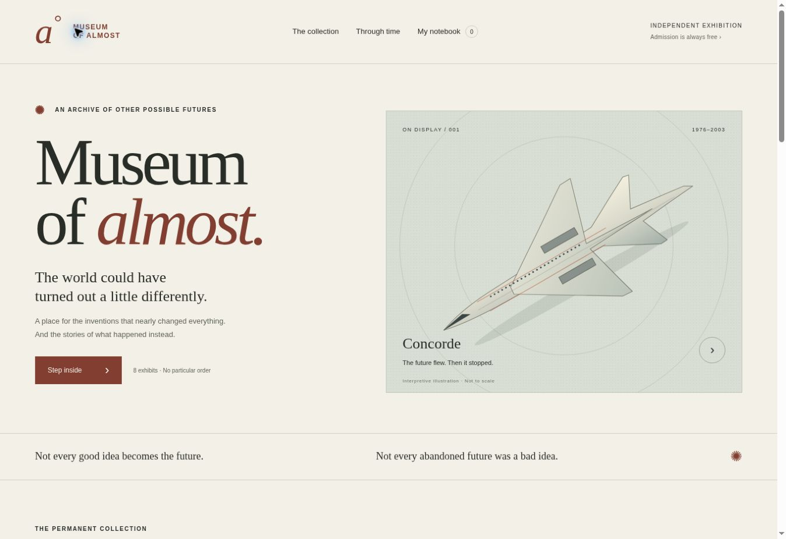

# Museum of Almost

An independent digital exhibition about inventions and futures that almost happened. Twenty objects, from Babbage’s Analytical Engine to Concorde, tell different stories about the distance between a compelling idea and a lasting reality.

**[Visit the museum](https://shricharanpadala.github.io/museum-of-almost/)**



The collection can be explored as a gallery, a timeline or one of six guided walks. Each exhibit brings its historical account together with references and a clearly marked counterfactual. A comparison room puts up to three histories beside one another, without pretending they share a single explanation.

Visitors can keep a private notebook in their own browser and export it as JSON. Shared links contain exhibit and filter choices, never notes. No account, API key, backend or ChatGPT subscription is required.

## Running locally

Use Node.js 22 or newer for the checks:

```sh
npm run check
npm test
```

There are no runtime dependencies or build step. Serve `docs/` using any ordinary static web server. For example, with Python installed:

```sh
python3 -m http.server 8080 --directory docs
```

Open `http://localhost:8080`. Opening `index.html` directly with a `file:` URL will not load the ES modules reliably.

## Architecture

| File | Responsibility |
| --- | --- |
| `docs/data.js` and `docs/expansion.js` | Curated exhibit records, source URLs and guided walks |
| `docs/core.js` | Search, route encoding, comparison rules and notebook validation |
| `docs/art.js` and `docs/new-art.js` | Original SVG object illustrations, with isolated gradient IDs |
| `docs/app.js` | Accessible dialogs, rendering, history and local notebook interactions |
| `docs/styles.css` | Responsive editorial design, reduced motion and print rules |
| `tests/core.test.js` | Data, search, persistence, import and URL regression tests |

The interface uses native dialog focus management, semantic buttons and form labels. Filters and exhibits have shareable hash URLs. Static asset paths work under a repository subdirectory. GitHub Actions runs syntax checks and the test suite on pushes and pull requests.

## Hosting

Published using GitHub Pages from `main` → `/docs`. The same folder can be deployed to another static host or served under a custom domain without changing the application. GitHub hosts both the code and the public website. There is no dependency on ChatGPT hosting.

## Editorial approach

Historical claims link to museum collections, institutional histories, original announcements or research. Each exhibit has two references. Source notes and interpretation boundaries are documented in [EDITORIAL.md](EDITORIAL.md).

The drawings are original, simplified illustrations. They are not archival photographs, engineering plans or precise reconstructions. Product and organisation names identify historical subjects; this independent project is not affiliated with them.

## Notebook behaviour

The notebook is stored under `museum-of-almost:v1` in browser local storage. It does not sync between devices. Private browsing, clearing site data or switching browsers can remove access to it, so use Export for a portable backup.

A malformed or unsupported stored notebook is left untouched. The app switches to in-memory notes and displays a warning. Import validates the complete file before changing anything, merges saved exhibits, and keeps conflicting notes together. Imports are limited to 100 KB and notes to 6,000 characters per exhibit. No analytics or third-party scripts are included.

## Contributing

See [CONTRIBUTING.md](CONTRIBUTING.md) for the exhibit format and editorial checks. Suggestions and source corrections are welcome through GitHub issues. This repository does not currently include an open-source licence.
